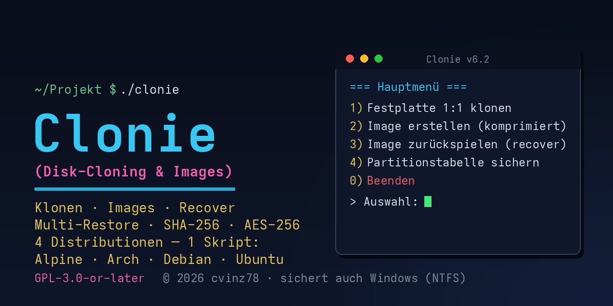

# clonie

<p align="center">
  
</p>

**clonie** – Festplatten klonen, Images erstellen und zurückschreiben,
alles über ein nummeriertes Menü. Ein einziges, in sich geschlossenes
Bash-Skript für Linux (Arch, Ubuntu/Debian, Alpine) – auch für
Windows-Platten (NTFS, MSR, EFI, WinRE).

> ⚠️ **Warnung:** Klonen und Zurückspielen **überschreibt das Ziel
> unwiderruflich**. Nur aus einem Live-System oder gegen Datenträger
> verwenden, die keine Systemplatten sind. Nutzung auf eigene Gefahr.

---

## Inhaltsverzeichnis

1. [Funktionsumfang](#funktionsumfang)
2. [Schnellstart](#schnellstart)
3. [Bedienung](#bedienung)
4. [Die einzelnen Funktionen im Detail](#die-einzelnen-funktionen-im-detail)
5. [Der Image-Host-Ordner](#der-image-host-ordner)
6. [Kompression](#kompression)
7. [Verschlüsselung (optional)](#verschlüsselung-optional)
8. [Windows-Platten](#windows-platten)
9. [Voraussetzungen](#voraussetzungen)
10. [Exit-Codes](#exit-codes)
11. [Sprache (DE/EN)](#sprache-deen)
12. [Farben](#farben)
13. [Lizenz](#lizenz)

---

## Funktionsumfang

| Hauptmenü-Punkt | Funktion |
|---|---|
| **Festplatte 1:1 klonen** | Komplette Platte blockweise auf eine andere Platte kopieren (inkl. Partitionstabelle) |
| **Partition 1:1 klonen** | Einzelne Partition auf eine andere Partition kopieren |
| **Image von Festplatte erstellen** | Komprimiertes Image einer ganzen Platte erzeugen |
| **Image von Partition(en) erstellen** | Image einer oder mehrerer Partitionen; mehrere landen in EINEM tar-Container und sind einzeln zurückspielbar |
| **Image zurückspielen (recover)** | Image auf Platte/Partition zurückschreiben; Einzel- und Partitions-Images werden automatisch erkannt, Prüfsummen verifiziert |
| **Partitionstabelle sichern** | sfdisk-Dump der Partitionstabelle einer Platte speichern |
| **Partitionstabelle zurückspielen** | Gesicherten Dump auf eine Platte zurückschreiben |
| **Image-Host-Ordner wählen/wechseln** | Ablageort für Images/Dumps festlegen (Laufwerk oder Pfad) |
| **Festplatten erneut einlesen** | Datenträgerliste auffrischen (nach dem Start angeschlossene Platten anzeigen) |

Darüber hinaus:

- **Multi-Restore für Partitions-Images:** alle Ziele in EINER Eingabe
  wählen (`1,3` oder `1-4`), zugeordnet in der Reihenfolge der
  Quellpartitionen – kein umständliches Einzeln-Restoren.
- **SHA-256-Verifikation:** jedes Image erhält eine Prüfsummendatei;
  beim Restore wird VOR dem Schreiben geprüft (äußere Datei, im
  Multi-Image zusätzlich je Partition/Member).
- **Ziel vergrößern:** nach Klonen/Restore auf eine größere Platte
  Partition und Dateisystem anpassen (NTFS via `ntfsresize`,
  ext via `e2fsck` + `resize2fs`, `parted resizepart`).
- **Automatische Benennung:** jede Sicherung landet in einem eigenen
  Unterordner `<Name>_<Datum/Zeit>`, das Image heißt
  `<Platte>_<Datum/Zeit>` – kein Rätselraten, welches Image was enthält.
- **Manifest:** jedes Image bekommt eine Manifest-Datei mit Quelle,
  Größe, Dateisystem und Blockgröße.
- **Sicherheitsnetzwerke:** Quell-/Ziel-Identitätsprüfung, Warnung wenn
  das Ziel eingehängt ist, Bestätigung vor jedem destruktiven Schritt,
  Sync nach Schreibvorgängen.

## Schnellstart

```console
$ sudo ./clonie
```

Beim Start werden fehlende Werkzeuge erkannt und (nach Bestätigung)
automatisch über den Paketmanager installiert (pacman / apt / apk).
Danach erscheint der Dialog für den **Image-Host-Ordner** (kann mit `0`
übersprungen werden) und das Hauptmenü.

Alle weiteren Optionen:

```console
$ sudo ./clonie            # interaktives Menü
$ ./clonie -h|--help       # Hilfe anzeigen
$ ./clonie -v|-V|--version    # Version anzeigen
$ ./clonie -nc|--no-color  # Farben deaktivieren (alte Konsolen)
$ ./clonie -de             # deutsche Texte (Standard)
$ ./clonie -en             # englische Texte
```

`-de`/`-en` können an beliebiger Argumentposition stehen und
überschreiben die Voreinstellung `SPRACHE="DE"` im Skript-Kopf.

## Bedienung

clonie ist vollständig menügesteuert: Platten, Partitionen, Images und
Dumps werden aus **nummerierten Listen** gewählt – nichts muss von Hand
getippt oder verwechselt werden.

**Steuerung in Auswahllisten und Freitext-Prompts:**

| Eingabe | Bedeutung |
|---|---|
| `0` | zurück (Vorgang abbrechen, zurück ins Hauptmenü) |
| `00` | clonie beenden (sauber, Exit 0) |
| `000` | abbrechen (Skript endet mit Exit 4) |

(Ausnahme: die Abfrage des Image-Host-Ordners am Beginn – `0` überspringt
sie.)

**Freitext-Eingaben** (Pfade, Namen) werden bei leerer Eingabe oder
Fehlern **erneut gefragt**, statt das Skript zu beenden; `0`/`00`/`000`
funktionieren auch dort. Ja/Nein-Fragen akzeptieren `j`/`n` und
`y`/`n` (+ Enter für den vorgeschlagenen Standardwert).

**Mehrfachauswahl** (Partitionen sichern, Multi-Restore): eine Partition
per Nummer (`3`), mehrere aufzählend (`3,4,5,6`) oder als Bereich
(`4-7`); gemischt ist erlaubt (`1,3,5-7`).

Vor jedem destruktiven Schritt (Klonen, Restore, Partitionstabelle
schreiben) zeigt clonie Quelle und Ziel nochmals an und verlangt eine
explizite Bestätigung.

## Die einzelnen Funktionen im Detail

### Festplatte 1:1 klonen

Kopiert eine komplette Platte blockweise (`dd`, 16M-Blöcke) auf eine
andere Platte – inklusive Partitionstabelle und Bootloadern. Die
Zielplatte wird vorher geprüft (mind. so groß wie die Quelle, nicht
eingehängt). Anschließend Angebot: Partition + Dateisystem an die
größere Zielplatte anpassen (falls größer).

### Partition 1:1 klonen

Kopiert eine einzelne Partition blockweise auf eine andere Partition
(Ziel-Partition wird ausgewählt, nicht automatisch erraten).

### Image von Festplatte erstellen

Erzeugt ein komprimiertes Vollimage (`<Platte>_<Zeit>.img.zst` u. ä.)
plus `.sha256`-Prüfsummendatei und Manifest. Fortschritt während dd
und Kompression wird angezeigt.

### Image von Partition(en) erstellen

Wie oben, aber für eine oder mehrere Partitionen. Mehrere Partitionen
landen in **EINEM tar-Container** (`<Platte>_<Zeit>.tar`), jede
Partition darin unter ihrem Gerätenamen (z. B. `sda3.img.zst`) – und
ist daraus **einzeln** zurückspielbar. Optional je Image
verschlüsselbar (siehe unten).

### Image zurückspielen (recover)

Erkennt automatisch den Image-Typ:

- **Einzelimage** (Platte oder Partition): Prüfsumme prüfen, dann auf
  das gewählte Ziel zurückschreiben.
- **Partitions-Image (.tar):** Multi-Restore – alle Ziele in einer
  Eingabe wählen, Zuordnung in der Reihenfolge der Quellpartitionen.
  Je Partition wird vor dem Schreiben die Member-Prüfsumme geprüft;
  ältere Images ohne Member-Prüfsummen fallen auf die äußere
  Gesamtprüfung zurück (mit Hinweis). Die Member werden im Image-Ordner
  neben dem tar-Container extrahiert – dort muss freier Platz für den
  größten gewählten Member (komprimiert) vorhanden sein.

Bei verschlüsselten Images wird das Passwort zuerst über die
Passcheck-Datei verifiziert – **bevor** irgendetwas überschrieben wird.
Nach dem Restore auf eine größere Platte: Angebot zum Anpassen von
Partition + Dateisystem.

### Partitionstabelle sichern / zurückspielen

Legt einen `sfdisk`-Dump (`<Platte>_<Zeit>.txt`) der Partitionstabelle
an – mit gesetztem Image-Host-Ordner landet er dort und wird beim
Zurückspielen zur Auswahl gelistet (`*.txt`, Manifeste ausgenommen).
Auch auf anderer Hardware/Platte zurückspielbar (GPT- und
MBR-Tabellen).

### Festplatten erneut einlesen

Liest Partitionstabellen per `partprobe` neu ein und zeigt die
aktuelle Datenträgerliste mit Einhäng-Status – für Platten, die nach
dem Skript-Start angeschlossen wurden.

## Der Image-Host-Ordner

Der zentrale Ablageort für Images, Prüfsummen, Manifeste und Dumps.
Am Beginn (oder jederzeit über das Hauptmenü) wählbar:

- **aus der Laufwerksliste** – Datenträger mit Dateisystem, gemountet
  oder zum Mounten angeboten, oder
- **per Pfadangabe** – beliebiges Verzeichnis, oder
- **überspringen** (`0`) – dann fragt jede Funktion ihr Ziel einzeln ab.

NTFS-Laufwerke werden zum Einhängen bevorzugt mit dem Kernel-Treiber
**ntfs3** gemountet (deutlich höhere Schreibrate als ntfs-3g/FUSE).
Läuft ein NTFS-Laufwerk bereits als fuseblk (ntfs-3g) – etwa vom
Desktop-Automounter eingehängt – bietet clonie das Neu-Einhängen mit
ntfs3 an, bei Geräten aus der Liste wie bei manuell eingegebenen Pfaden.

Struktur pro Sicherung:

```
<Image-Host-Ordner>/
└── <Name>_<Datum/Zeit>/          # Name wird erfragt
    ├── sda_20261019-1530.img.zst # Image heißt <Platte>_<Zeit>
    ├── sda_20261019-1530.img.zst.sha256
    └── sda_20261019-1530.manifest.txt
```

Beim Restore werden Unterordner und darin liegende Images als
nummerierte Listen zur Auswahl angeboten. Datenträger, die clonie
selbst als Image-Host-Ordner eingehängt hat, werden beim Beenden
wieder ausgehängt. Ist der Ordner nicht beschreibbar (z. B. nur-Lesen-
Medium), schaltet clonie in den Nur-Restore-Modus.

## Kompression

| Format | Endung | Bemerkung |
|---|---|---|
| **zstd** (Standard) | `.img.zst` | multithreaded, schnellste beste Wahl |
| xz (Fallback) | `.img.xz` | falls zstd fehlt |
| gzip (Fallback) | `.img.gz` | letzter Fallback |

Die Kompressionsstufe wird im Dialog gewählt (zstd-Level 3 ist
vorausgewählt). Fehlt zstd, wird xz/gzip automatisch angeboten.

## Verschlüsselung (optional)

Bei der Image-Erstellung wahlweise zuschaltbar: **AES-256** (openssl,
PBKDF2), angewendet nach der Kompression – Endung `.enc`.

- Einzelimages: die gesamte komprimierte Datei ist verschlüsselt.
- Partitions-Images (tar): die **enthaltenen Partitionsdateien sind
  einzeln verschlüsselt**; der tar-Container selbst bleibt lesbar
  (Namen/Größen sichtbar, Inhalte geschützt).
- Eine **Passcheck-Datei** landet mit im Image und verifiziert das
  Passwort beim Restore **vor** jedem Schreibvorgang.

> ⚠️ **ACHTUNG:** Geht das Passwort verloren, sind die Daten
> **unwiederbringlich** verloren – es gibt keine Rettungsmöglichkeit mehr.

## Windows-Platten

- NTFS-Erkennung (auch als Restore-Ziel)
- **Schnellstart-Warnung:** ist Windows nicht komplett heruntergefahren
  (Schnellstart/Hibernate), kann das Image inkonsistent sein – clonie
  warnt davor
- **BitLocker-Hinweis** bei erkannter Verschlüsselung
- `ntfsresize` zum Vergrößern nach Klon/Restore auf größere Platten
  (Paket `ntfs-3g`)

## Voraussetzungen

- Linux, **root**-Rechte (`sudo`)
- **Basis-Tools:** `lsblk`, `blkid`, `blockdev`, `dd`, `sha256sum`,
  `sfdisk`, `partprobe`, `parted`, `mountpoint`, `sync`, `awk`,
  `grep`, `sed`
- **Kompression:** `zstd` (empfohlen) oder `xz`/`gzip`
- **Optional:** `openssl` (Verschlüsselung), `ntfsresize`/`ntfsfix`
  (Windows-Platten), `e2fsck`/`resize2fs` (ext-Vergrößerung, e2fsprogs)

Fehlende Tools werden beim Start erkannt und nach Bestätigung
automatisch installiert (Arch/pacman, Ubuntu+Debian/apt,
Alpine/apk). Unterstützte Geräte: SATA/NVMe-Platten, USB-Laufwerke,
Loop-Devices.

## Exit-Codes

| Code | Bedeutung |
|---|---|
| `0` | Erfolg (auch: Beenden über `00`) |
| `2` | Falsche Argumente (Usage) |
| `3` | Fataler Fehler |
| `4` | Vom Benutzer abgebrochen (Eingabe `000`) |

## Sprache (DE/EN)

```console
$ sudo ./clonie -en    # englische Texte
$ sudo ./clonie -de    # deutsche Texte (Standard)
```

Dauerhaft einstellbar über `SPRACHE="DE"` / `"EN"` im Skript-Kopf
(Variable am Dateianfang). Bei `-en` erzeugt clonie einmalig eine
übersetzte Kopie seiner selbst und führt diese aus – der deutsche
Codepfad bleibt unangetastet. **Manifest-Schlüssel bleiben bewusst
deutsch** (`Quellgröße_bytes` u. a.), damit Images über beide Sprachen
hinweg wiederherstellbar sind.

## Farben

Farbige Ausgabe gemäß Farbschema (Überschriften grün, Text/Geräte
cyan, Warnungen rot, Dateien/Befehle lila). Abschaltbar per
`-nc`/`--no-color` (alte Konsolen) oder `NO_COLOR=1` in der Umgebung.

## Lizenz

Copyright (C) 2026 cvinz78

Dieses Programm ist freie Software: Sie können es unter den Bedingungen
der **GNU General Public License** (wie von der Free Software
Foundation veröffentlicht, Version 3 der Lizenz oder (nach Ihrer Wahl)
eine spätere Version) weitergeben und/oder modifizieren.

Dieses Programm wird in der Hoffnung verteilt, dass es nützlich ist,
aber **OHNE JEDE GEWÄHRLEISTUNG**; ohne selbst die implizite Gewähr
der MARKTFÄHIGKEIT oder EIGNUNG FÜR EINEN BESTIMMTEN ZWECK. Details
in der [GNU General Public License](LICENSE).

---

# clonie (English)

**clonie** – clone disks, create images and write them back, all through
a numbered menu. A single, self-contained Bash script for Linux (Arch,
Ubuntu/Debian, Alpine) – also for Windows disks (NTFS, MSR, EFI, WinRE).

> ⚠️ **Warning:** Cloning and restoring **irrevocably overwrites the
> target**. Only use from a live system or against disks that are not
> system disks. Use at your own risk.

---

## Table of Contents

1. [Features](#features)
2. [Quick Start](#quick-start)
3. [Operation](#operation)
4. [The Functions in Detail](#the-functions-in-detail)
5. [The Image Host Directory](#the-image-host-directory)
6. [Compression](#compression)
7. [Encryption (optional)](#encryption-optional)
8. [Windows Disks](#windows-disks)
9. [Requirements](#requirements)
10. [Exit Codes](#exit-codes)
11. [Language (DE/EN)](#language-deen)
12. [Colors](#colors)
13. [License](#license)

---

## Features

| Main menu item | Function |
|---|---|
| **Clone disk 1:1** | Copy an entire disk block by block to another disk (including partition table) |
| **Clone partition 1:1** | Copy a single partition to another partition |
| **Create disk image** | Create a compressed image of a whole disk |
| **Create partition image(s)** | Image one or several partitions; several go into ONE tar container and are individually restorable |
| **Restore image (recover)** | Write an image back to disk/partition; single and partition images are detected automatically, checksums verified |
| **Save partition table** | Store an sfdisk dump of a disk's partition table |
| **Restore partition table** | Write a saved dump back to a disk |
| **Choose/switch image host directory** | Set the storage location for images/dumps (drive or path) |
| **Re-scan disks** | Refresh the drive list (show disks attached after start) |

In addition:

- **Multi-restore for partition images:** select all targets in ONE
  entry (`1,3` or `1-4`), assigned in the order of the source
  partitions – no laborious one-by-one restoring.
- **SHA-256 verification:** every image gets a checksum file; on
  restore it is checked BEFORE writing (outer file, in multi-images
  additionally per partition/member).
- **Enlarge target:** after cloning/restoring to a larger disk, adjust
  partition and file system (NTFS via `ntfsresize`, ext via
  `e2fsck` + `resize2fs`, `parted resizepart`).
- **Automatic naming:** every backup goes into its own subdirectory
  `<name>_<date/time>`, the image is named `<disk>_<date/time>` – no
  guessing which image contains what.
- **Manifest:** every image gets a manifest file with source, size,
  file system and block size.
- **Safety nets:** source/target identity check, warning when the
  target is mounted, confirmation before every destructive step, sync
  after write operations.

## Quick Start

```console
$ sudo ./clonie
```

At start, missing tools are detected and (after confirmation)
installed automatically via the package manager (pacman / apt / apk).
Then the **image host directory** dialog appears (can be skipped with
`0`) and the main menu.

All further options:

```console
$ sudo ./clonie            # interactive menu
$ ./clonie -h|--help       # show help
$ ./clonie -v|-V|--version    # show version
$ ./clonie -nc|--no-color  # disable colors (old consoles)
$ ./clonie -de             # German texts (default)
$ ./clonie -en             # English texts
```

`-de`/`-en` may appear at any argument position and override the
default `SPRACHE="DE"` in the script header.

## Operation

clonie is fully menu-driven: disks, partitions, images and dumps are
chosen from **numbered lists** – nothing has to be typed by hand or
can be mixed up.

**Controls in selection lists and free-text prompts:**

| Input | Meaning |
|---|---|
| `0` | back (abort the operation, return to main menu) |
| `00` | quit clonie (cleanly, exit 0) |
| `000` | abort (script ends with exit 4) |

(Exception: the image host directory prompt at the beginning – `0`
skips it.)

**Free-text inputs** (paths, names) are **asked again** on empty input
or errors instead of terminating the script; `0`/`00`/`000` work there
too. Yes/no questions accept `j`/`n` and `y`/`n` (+ Enter for the
suggested default).

**Multi-selection** (back up partitions, multi-restore): one partition
by number (`3`), several as a list (`3,4,5,6`) or as a range (`4-7`);
mixing is allowed (`1,3,5-7`).

Before every destructive step (clone, restore, write partition table)
clonie shows source and target again and requires an explicit
confirmation.

## The Functions in Detail

### Clone disk 1:1

Copies an entire disk block by block (`dd`, 16M blocks) to another
disk – including partition table and bootloaders. The target disk is
checked beforehand (at least as large as the source, not mounted).
Afterwards an offer: adjust partition + file system to the larger
target disk (if larger).

### Clone partition 1:1

Copies a single partition block by block to another partition (the
target partition is selected, not guessed automatically).

### Create disk image

Creates a compressed full image (`<disk>_<time>.img.zst` etc.) plus
`.sha256` checksum file and manifest. Progress is shown during dd and
compression.

### Create partition image(s)

Like above, but for one or several partitions. Several partitions go
into **ONE tar container** (`<disk>_<time>.tar`), each partition under
its device name (e.g. `sda3.img.zst`) – and is **individually**
restorable from it. Optionally encryptable per image (see below).

### Restore image (recover)

Detects the image type automatically:

- **Single image** (disk or partition): verify checksum, then write
  back to the chosen target.
- **Partition image (.tar):** multi-restore – select all targets in one
  entry, assignment in the order of the source partitions. Per
  partition the member checksum is checked before writing; older
  images without member checksums fall back to the outer overall
  check (with a notice). Members are extracted next to the tar
  container in the image directory – it must hold free space for the
  largest selected member (compressed).

For encrypted images the password is verified first via the passcheck
file – **before** anything is overwritten. After restoring to a larger
disk: offer to adjust partition + file system.

### Save / restore partition table

Creates an `sfdisk` dump (`<disk>_<time>.txt`) of the partition table –
with an image host directory set, it lands there and is listed for
restoring (`*.txt`, manifests excluded). Also restorable on other
hardware/disks (GPT and MBR tables).

### Re-scan disks

Re-reads partition tables via `partprobe` and shows the current drive
list with mount status – for disks attached after the script started.

## The Image Host Directory

The central storage location for images, checksums, manifests and
dumps. Chosen at the beginning (or any time via the main menu):

- **from the drive list** – volumes with a file system, mounted or
  offered for mounting, or
- **by path** – any directory, or
- **skip** (`0`) – then each function asks for its target separately.

NTFS volumes are preferably mounted with the **ntfs3** kernel driver
(much higher write rate than ntfs-3g/FUSE). If an NTFS volume is already
mounted as fuseblk (ntfs-3g) – e.g. by the desktop automounter – clonie
offers remounting with ntfs3, both for devices from the list and for
manually entered paths.

Structure per backup:

```
<image host directory>/
└── <name>_<date/time>/          # name is asked
    ├── sda_20261019-1530.img.zst # image named <disk>_<time>
    ├── sda_20261019-1530.img.zst.sha256
    └── sda_20261019-1530.manifest.txt
```

On restore, subdirectories and the images inside are offered as
numbered lists. Drives that clonie mounted itself as image host
directory are unmounted on exit. If the directory is not writable
(e.g. read-only medium), clonie switches to restore-only mode.

## Compression

| Format | Suffix | Note |
|---|---|---|
| **zstd** (default) | `.img.zst` | multithreaded, fastest best choice |
| xz (fallback) | `.img.xz` | if zstd is missing |
| gzip (fallback) | `.img.gz` | last fallback |

The compression level is chosen in the dialog (zstd level 3 is
preselected). If zstd is missing, xz/gzip are offered automatically.

## Encryption (optional)

Optionally enabled at image creation: **AES-256** (openssl, PBKDF2),
applied after compression – suffix `.enc`.

- Single images: the entire compressed file is encrypted.
- Partition images (tar): the **contained partition files are
  individually encrypted**; the tar container itself stays readable
  (names/sizes visible, contents protected).
- A **passcheck file** is included in the image and verifies the
  password on restore **before** every write operation.

> ⚠️ **WARNING:** If the password is lost, the data is lost
> IRRECOVERABLY - there is no recovery path.

## Windows Disks

- NTFS detection (also as restore target)
- **Fast startup warning:** if Windows was not completely shut down
  (fast startup/hibernate), the image may be inconsistent – clonie
  warns about this
- **BitLocker notice** when encryption is detected
- `ntfsresize` for enlarging after clone/restore to larger disks
  (package `ntfs-3g`)

## Requirements

- Linux, **root** privileges (`sudo`)
- **Base tools:** `lsblk`, `blkid`, `blockdev`, `dd`, `sha256sum`,
  `sfdisk`, `partprobe`, `parted`, `mountpoint`, `sync`, `awk`,
  `grep`, `sed`
- **Compression:** `zstd` (recommended) or `xz`/`gzip`
- **Optional:** `openssl` (encryption), `ntfsresize`/`ntfsfix`
  (Windows disks), `e2fsck`/`resize2fs` (ext growing, e2fsprogs)

Missing tools are detected at start and installed automatically after
confirmation (Arch/pacman, Ubuntu+Debian/apt, Alpine/apk). Supported
devices: SATA/NVMe disks, USB drives, loop devices.

## Exit Codes

| Code | Meaning |
|---|---|
| `0` | success (also: quit via `00`) |
| `2` | wrong arguments (usage) |
| `3` | fatal error |
| `4` | aborted by the user (input `000`) |

## Language (DE/EN)

```console
$ sudo ./clonie -en    # English texts
$ sudo ./clonie -de    # German texts (default)
```

Set permanently via `SPRACHE="DE"` / `"EN"` in the script header
(variable at the top of the file). With `-en` clonie creates a
translated copy of itself once and runs it – the German code path
remains untouched. **Manifest keys deliberately stay German**
(`Quellgröße_bytes` etc.) so images remain restorable across both
languages.

## Colors

Colored output according to the color scheme (headings green,
text/devices cyan, warnings red, files/commands magenta). Disable via
`-nc`/`--no-color` (old consoles) or `NO_COLOR=1` in the environment.

## License

Copyright (C) 2026 cvinz78

This program is free software: you can redistribute it and/or modify
it under the terms of the **GNU General Public License** as published
by the Free Software Foundation, either version 3 of the License, or
(at your option) any later version.

This program is distributed in the hope that it will be useful, but
**WITHOUT ANY WARRANTY**; without even the implied warranty of
MERCHANTABILITY or FITNESS FOR A PARTICULAR PURPOSE. See the
[GNU General Public License](LICENSE) for details.
